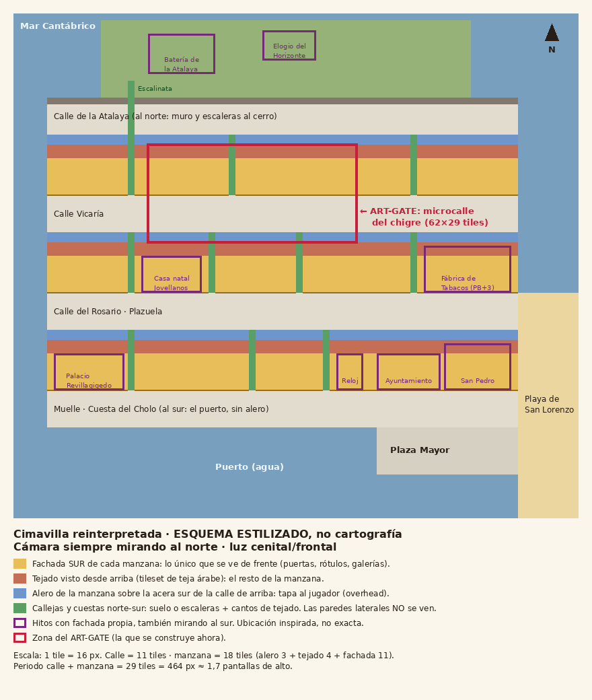
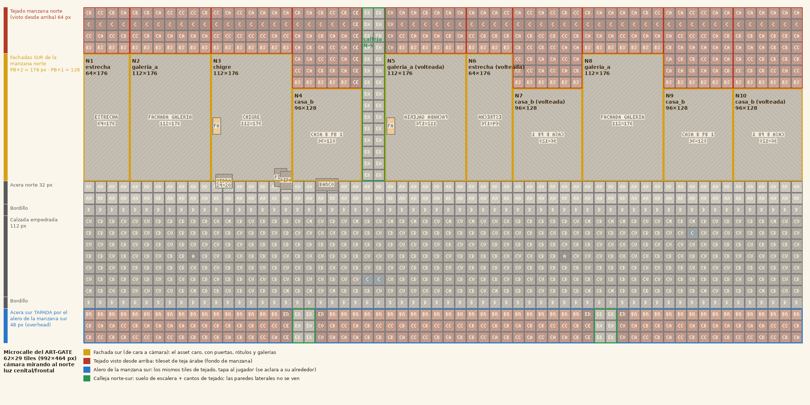

# Mapa y orientación de los edificios

En 2D cada asset vale solo para una orientación. Por eso el mapa se fija **antes** de seguir produciendo edificios.

## Reglas (no negociables en una vista 3/4 frontal)
1. **La cámara siempre mira al norte.** Nada rota.
2. **De cada edificio solo se dibuja su fachada SUR**, en alzado frontal, y **su tejado visto desde arriba**. Las fachadas norte, este y oeste **no se ven**: las tapa el tejado o quedan de canto.
3. **Calles este-oeste.** Al norte de la calle quedan las fachadas completas (lo caro: puertas, rótulos, galerías). Al sur queda el **alero** de la manzana siguiente, que tapa la acera sur y se aclara alrededor del jugador.
4. **Calles norte-sur** (callejas, cuestas, escaleras): solo suelo y los cantos del tejado a cada lado. Son baratas.
5. **Todo edificio importante** (chigre, tiendas, hitos) va mirando al sur. Si en la Cimavilla real da a otra calle, se recoloca.
6. **Sin perspectiva cónica ni punto de fuga.** Una fachada tiene que poder moverse a cualquier punto de la fila sin que se note.
7. **Luz cenital/frontal.** Laterales, esquinas y props se pueden **voltear** horizontalmente, lo que ahorra la mitad de las piezas. No pintéis sombras que delaten un lado concreto.

## Medidas estándar (rejilla de 16 px)
| Pieza | Medida |
|---|---|
| Calle (acera 2 + bordillo + calzada 7 + bordillo) | 11 tiles = 176 px |
| Manzana (alero 3 + tejado visible 4 + fachada 11) | 18 tiles = 288 px |
| Fachada PB+2 / PB+1 / singular PB+3 | **176** / **128** / 224 px de alto (incluido el alero propio) |
| Ancho de fachada | múltiplo de 16 px: 64 (estrecha), 96, 112… |
| Tejado | **tileset** de teja árabe 16×16; el tejado de cada casa sale de ahí, no se pinta en la fachada |

## (A) Esquema del barrio (provisional, solo orientación)
> ⚠️ **Superado por [03-BARRIO.md](03-BARRIO.md):** la ciudad será **ficticia**, más grande (2–3 min de punta a punta), con varios niveles y el puerto jugable. Este esquema con nombres reales solo ilustra las reglas de orientación. El trazado definitivo lo propondrá Claude después del ART-GATE.

## (B) Microcalle del ART-GATE (la que se construye ahora)
Sale del mapa real del prototipo (`maps/gate.tmj`); los placeholders se sustituirán por vuestras piezas.

| Solar | Encargo | Tamaño | Notas |
|---|---|---|---|
| N1 | Casa estrecha (E8b) | 64×176 | PB+2 |
| N2 | Casa con galería (E3) | 112×176 | PB+2 |
| N3 | **Chigre** (E4) | 112×176 | PB+2; rótulo en capa aparte |
| N4 | Casa B (E8) | 96×128 | PB+1; se ve más tejado encima |
| Calleja | Escaleras (E2) + cantos de tejado (E9) | 32 px de ancho | Sube hacia el norte |
| N5 | Casa con galería (E3) **volteada** | 112×176 | Prueba de reutilización |
| N6 | Casa estrecha volteada | 64×176 | |
| N7 | Casa B volteada | 96×128 | |
| N8 | Casa con galería | 112×176 | |
| N9 / N10 | Casa B / Casa B volteada | 96×128 | |
| Lado sur | Alero de teja (E9) con dos callejas que bajan al muelle | banda de 48 px | |

Con solo **3 fachadas distintas + el chigre** se llena la calle, porque voltearlas y (más adelante) cambiarles el color del revoco dan la variedad. Eso es lo que hay que demostrar: **piezas recombinables**.

## Qué cambia para lo que ya tenéis hecho
- **Fachadas:** solo la cara sur, en alzado. Si alguna lleva pared lateral o perspectiva, hay que rehacerla de frente.
- **Tejados:** si la fachada trae el tejado pintado, la recorto por el alero. El tejado de verdad sale del tileset (E9).
- **Esquinas:** la fachada termina en su sillería; no hace falta pintar el lateral.
- **Luz:** si está muy marcada desde un lado, se nota al voltear. Mejor cenital.
